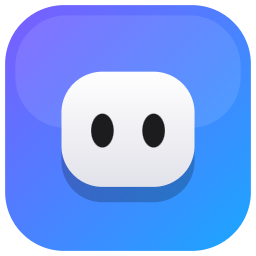

<p align="center"></p>

<h1 align="center">WinLand</h1>
<p align="center"><b>Ma Dynamic Island perso pour Windows, avec Pip dedans.</b><br>
100 % locale : rien n'est envoyé sur internet, pas de compte, pas de serveur.</p>

---

## Ce qu'elle fait

| | |
| --- | --- |
| **Claude Code et Codex en direct** | Quel fichier l'IA lit, ce qu'elle modifie, quelle commande elle lance. L'island s'allume en orange (en cours), vert (terminé) ou rouge (erreur) |
| **Autoriser en un clic** | Quand l'IA demande une permission (par exemple `bun install`), tu acceptes ou refuses directement dans l'island |
| **Répondre depuis l'island** | Quand Claude s'arrête, tu tapes ta réponse dans l'island et il reprend |
| **Limite de 5 heures** | Un anneau montre combien de ta limite Claude tu as utilisé |
| **Musique** | N'importe quel lecteur : Spotify, Apple Music, Deezer, TIDAL, YouTube Music dans le navigateur… Pochette, titre, lecture/pause, suivant, précédent. Aucun compte à lier |
| **Pip** | Vise une fenêtre (`Ctrl+Alt+Espace`) et pose-lui une question (il utilise Claude Code ou Codex déjà installés sur ton PC). Il danse sur la musique, prend soin de toi (pause des yeux, eau, il bâille le soir) et peut se balader sur ton bureau |
| **Petits outils** | Tiroir à fichiers, presse-papiers, note rapide, minuteur focus, volume, batterie Bluetooth |
| **Palette de commandes** | `Alt+Espace` : une app, un fichier récent, un projet, un calcul, une conversion, « claude: … », « minuteur 5 min », « rappel 20 min … », « mode réunion », la pipette, « port 3000 », ton temps d'écran, tes scripts |
| **Notifications et micro** | Les notifications Windows (Discord, Outlook, Teams…) arrivent dans l'island. Pendant un appel, un bouton coupe le micro de tout le PC (`Ctrl+Alt+M`) |
| **Live** | Le texte de tes captures copié tout seul, l'agenda Windows du jour, plusieurs minuteurs et rappels, presse-papiers intelligent, modes Réunion / Nuit / Streaming |
| **Automatisations** | Des règles « quand X, alors Y » : un jeu se lance, un casque se branche, Claude a fini pendant ton absence, il est 23 h… |
| **Tableau de bord Claude** | Toutes tes sessions, ta consommation, et une file de tâches que Claude Code fait l'une après l'autre |
| **Téléphone** | Ton téléphone comme télécommande sur ton Wi-Fi : scanne le QR code, tape le code à 6 chiffres affiché par WinLand. Claude, musique, focus, micro, modes, ou mode **Stream Deck** : tes propres boutons (apps, liens, dossiers, scripts, raccourcis clavier, texte, volume, minuteurs, tâches Claude…), créés dans l'éditeur sur le PC |
| **Par profil** | Logiciels installés, pipette et ports (Développement), accordeur, BPM et notes vocales (Studio) |
| **À ton goût** | Français ou anglais, thème sombre ou clair, démarrage avec Windows (activable/désactivable) |

**Raccourcis :** `Alt+Espace` palette, `Ctrl+Alt+M` micro, `Ctrl+Alt+Espace` viser une fenêtre, `Ctrl+Alt+T` ramène l'island, `Ctrl+Alt+1–6` ouvre une app.
Clic droit sur Pip à côté de l'horloge : ouvrir, paramètres, démarrer avec Windows, redémarrer, quitter.

## Lancer

Il faut [Bun](https://bun.sh) (pas besoin de Node.js) et Windows PowerShell 5.1 (déjà dans Windows).

```powershell
bun install
bun run start
```

`bun install` crée aussi **`WinLand.exe`** dans ce dossier : ensuite, un double-clic dessus suffit (sans fenêtre de console).
Le premier lancement télécharge Electron et compile `winland-helper.exe`, un petit programme local qui remplace les scripts PowerShell.

`bun test` lance les tests.

### Connecter Claude Code ou Codex

Paramètres → **Connexions** → active Claude Code et/ou Codex. WinLand ajoute ses hooks dans `~/.claude/settings.json`
(et `~/.codex/hooks.json`). Ils parlent seulement à `127.0.0.1` : tout reste sur ton PC.

## Installateur

`bun run build:setup` fabrique `dist/WinLand-Setup.exe`, entièrement sur ce PC (rien n'est téléchargé) :
un installateur au design de WinLand (accueil avec Pip, langue, thème, profil, démarrage avec Windows, icône sur le Bureau).
WinLand s'installe pour ton compte dans `%LOCALAPPDATA%\Programs\WinLand`, sans droits administrateur, et se
désinstalle depuis « Applications installées » (tes réglages peuvent rester).
Windows SmartScreen prévient au premier lancement : l'installateur n'est pas signé.

## Confidentialité

Tout tourne en local. L'état de Claude Code et de Codex arrive par un petit serveur sur `127.0.0.1`. La musique est lue
dans la session média de Windows. Il n'y a ni météo, ni agenda en ligne, ni mise à jour automatique, ni statistiques.
Quand tu poses une question à Pip, elle passe par Claude Code ou Codex, exactement comme dans ton terminal.
